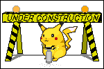

### ‎ >_ `#include <algoritmos>` | Resoluções em C++

[](./gif.gif)

```cpp
#include <bits/stdc++.h>
using namespace std;

int main() {
    ios_base::sync_with_stdio(false);
    cin.tie(nullptr);

    cout << "Algoritmos 1, 2 e 3 + Codetroopers✿" << endl;
    return 0;
}
```

> **Legenda:** ☑ `AC` (resolvido)  •  ☐ `WIP` (em andamento)

* * *

### ✉︎ Sobre o Repositório

`cout << "sobre" << endl;`

- [x] `const auto disciplinas` Resoluções de **Algoritmos 1, 2 e 3 e provas de Programação Competitiva com a Codetroopers**
- [x] `string linguagem = "C++17";` Todas as soluções escritas em **C++**
- [x] `map<tipo, pasta>` Organizado por disciplina e por **tipo de problema**
- [ ] `// TODO` Novas questões sendo adicionadas conforme eu resolvo ✿

* * *

### ✉︎ Estrutura

`namespace repo { /* tree */ }`

```
.
├── README.md
├── gif.gif
├── algoritmos-1/
│   ├── tipo-de-problema-a/
│   │   ├── README.md // enunciados
│   │   ├── problema_01.cpp
│   │   └── problema_02.cpp
│   └── tipo-de-problema-b/
├── algoritmos-2/
│   └── ...
└── algoritmos-3/
    └── ...
├── competitive-programming/
│   ├── prova-a/
│   │   ├── prova-a.pdf // enunciados
│   │   ├── prova-a.md // resolução comentada
│   │   ├── problema_01.cpp
│   │   └── problema_02.cpp
│   └── prova-b/
```

* * *

### ✉︎ Algoritmos 1

`vector<string> topicos = { ... };`

| Tópico | Problemas | Status |
|:-------|:---------:|:------:|
| [Tópico A](./algoritmos-1/topico-a/README.md) | 0 | ☐ |
| [Tópico B](./algoritmos-1/topico-b/README.md) | 0 | ☐ |
| [Tópico C](./algoritmos-1/topico-c/README.md) | 0 | ☐ |

* * *

### ✉︎ Algoritmos 2

`map<string, int> topicos = { ... };`

| Tópico | Problemas | Status |
|:-------|:---------:|:------:|
| [Tópico A](./algoritmos-2/topico-a/README.md) | 0 | ☐ |
| [Tópico B](./algoritmos-2/topico-b/README.md) | 0 | ☐ |
| [Tópico C](./algoritmos-2/topico-c/README.md) | 0 | ☐ |

* * *

### ✉︎ Algoritmos 3

`set<string> topicos = { ... };`

| Tópico                                    | Problemas | Status |
|:------------------------------------------|:---------:|:------:|
| [Árvore](./algoritmos-3/arvore/README.md)          |    13     |   ☑   |
| [Prova 2](./algoritmos-3/provas/prova-2/README.md) |     2     |   ☐   |

* * *

### ✉︎ Como Compilar

`system("g++ -std=c++17 main.cpp");`

```bash
# compilar
g++ -std=c++17 -O2 -Wall arquivo.cpp -o arquivo

# executar com a entrada de um arquivo
./arquivo < entrada.txt
```

* * *